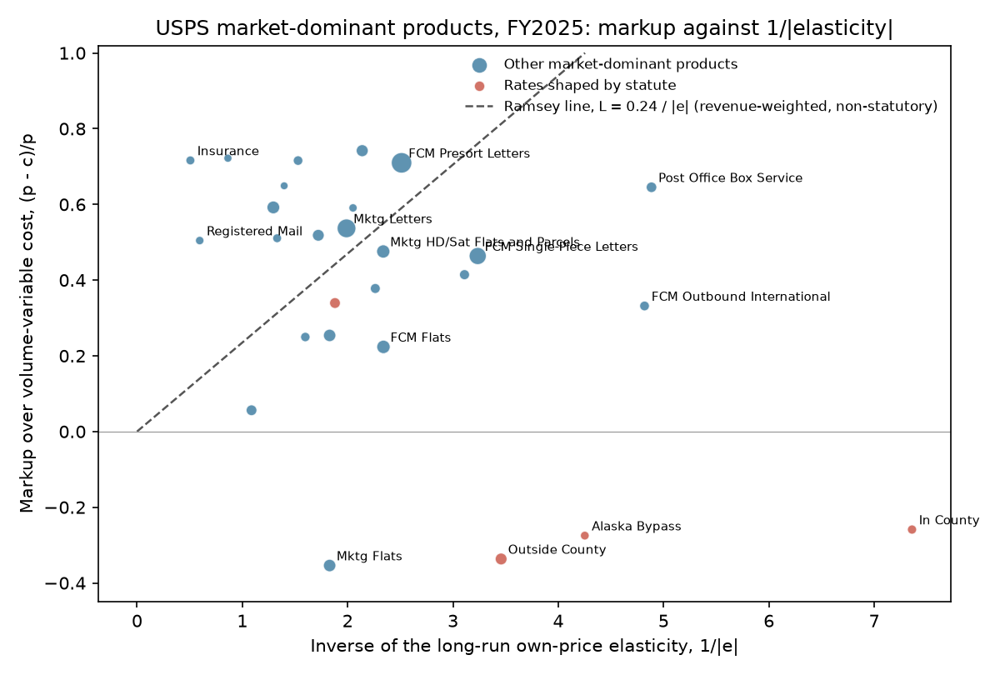
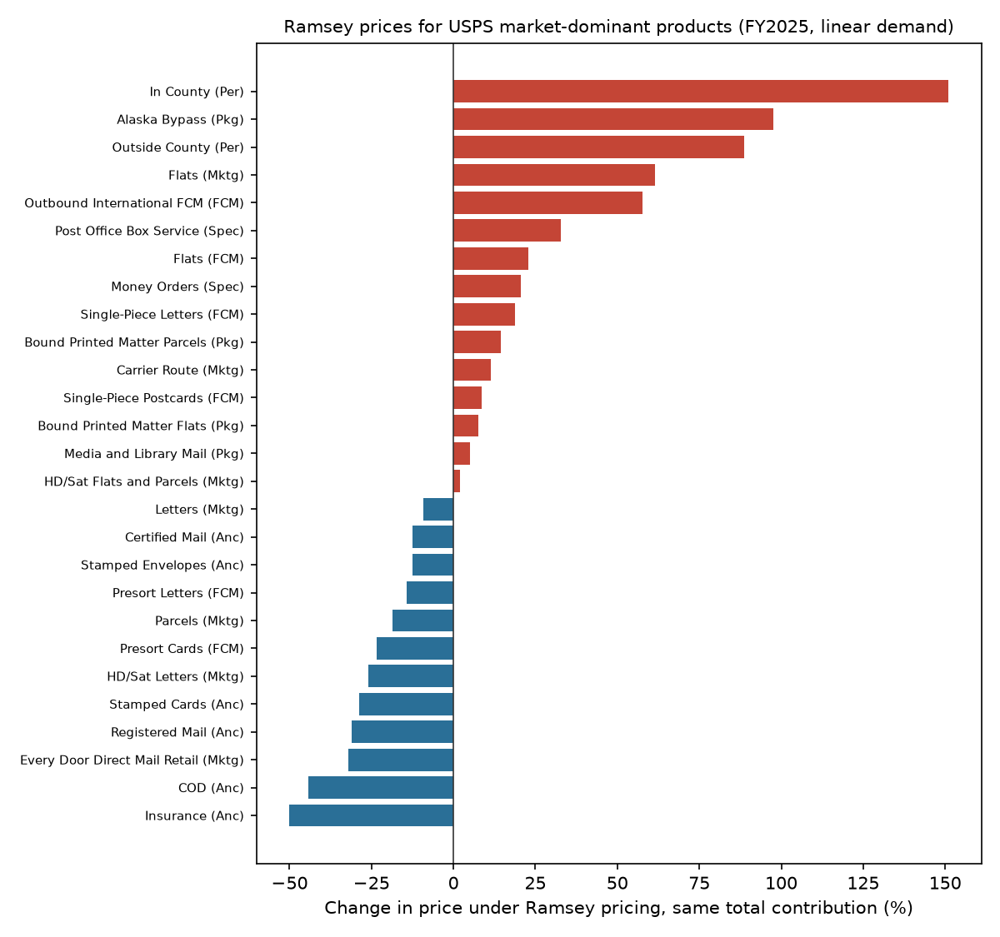

# The Price of a Stamp

### In 1927, Frank Ramsey worked out how to raise a fixed sum with the least harm, by charging most where buyers have the fewest ways out. I checked whether the Postal Service's 2025 prices follow his rule.

---

On July 13, 2025, the Forever stamp went from 73 to 78 cents. In the same price change the Postal Service cut what it
charges for postal insurance by 12 percent. Over the fiscal year that ended that September, the Postal Service took
in an average of 72.3 cents for every single-piece First-Class letter, against 38.8 cents of cost that rises and
falls with the number of letters handled. A presorted business letter, the kind that carries a bank statement or a
utility bill, brought in 55.3 cents and cost 16.0 cents. A USPS Marketing Mail letter, the credit-card offer in a window
envelope, brought in 27.6 cents and cost 12.8.

The gaps between those prices and costs are not profit in the ordinary sense. In fiscal 2025 the Postal Service
spent $90.3 billion and took in $81.4 billion, and $44.1 billion of its costs belonged to no product at all. They
are the cost of a network that reaches every address in the country, and they have to be recovered somehow, from
someone. Deciding who pays them is a pricing problem with a precise answer in economics, and the answer was first
published in 1927 by a 24-year-old mathematician at Cambridge.

---

## Two numbers per product

The first number is the markup, which economists call the Lerner index. It is the share of the price that sits
above marginal cost, the cost of handling one more piece:

```math
L_i \equiv \frac{p_i - c_i}{p_i}
```

Here $`p_i`$ is the price of product $`i`$ and $`c_i`$ its marginal cost. For a single-piece letter in fiscal 2025,
with revenue of 72.29 cents and volume-variable cost of 38.77 cents per piece:

```math
L_{\text{single-piece letter}} = \frac{72.29 - 38.77}{72.29} = 0.464
```

So 46 cents of every dollar spent on single-piece letters went toward costs that do not vary with volume. The Postal Regulatory Commission reports
the same comparison as cost coverage, revenue divided by attributable cost, which for these letters was 180%.

The second number is the own-price elasticity of demand, the percentage fall in volume when the price rises by one
percent. Ramsey's rule says the markup times the elasticity should come out the same for every product. I call that
product the Ramsey number:

```math
\varepsilon_i = -\frac{\partial q_i}{\partial p_i}\,\frac{p_i}{q_i}, \qquad \lambda_i \equiv L_i \, \varepsilon_i
```

where $`q_i`$ is volume. The Postal Service's own long-run elasticity for single-piece letters is 0.309, so their
Ramsey number is 0.464 × 0.309 = 0.143. Three products show the range.

| Product, FY2025 | Markup over marginal cost | Elasticity | Ramsey number |
|---|---|---|---|
| Postal insurance | 0.716 | 1.974 | 1.414 |
| Single-piece First-Class letters | 0.464 | 0.309 | 0.143 |
| Periodicals mailed outside the county | −0.337 | 0.289 | −0.097 |

If Ramsey's rule held, the last column would read the same number three times. Insurance customers drop the service
quickly when its price rises, yet they paid the highest markup of the three. Magazines barely respond to price and
were sold below cost.

---

## Frank Ramsey's question

Frank Plumpton Ramsey was born in Cambridge on February 22, 1903, and died in London on January 19, 1930, at 26. He
was elected a fellow of King's College, Cambridge, in 1924, and he is remembered at least as much by philosophers
and logicians as by economists. He wrote two papers in economics, both in the *Economic Journal*. The first, "A
Contribution to the Theory of Taxation," appeared in March 1927. The problem, he wrote in it, had been suggested to
him by Arthur Pigou.

The question was how a government that must raise a given revenue through taxes on different goods should set the
rates so that the loss of welfare is as small as possible. The obvious answer is to tax everything at the same rate,
and Ramsey showed that the obvious answer is wrong. His first result is that for a small revenue the taxes should
cut the output of every taxed good by the same proportion. When demands and supplies are independent, that becomes
a rule about elasticities (his equation 12, page 56). The tax rate on each good, $`\tau_i`$, should be proportional
to the sum of the inverses of its demand elasticity $`\rho_i`$ and its supply elasticity $`e_i`$:

```math
\frac{\tau_1}{\dfrac{1}{\rho_1} + \dfrac{1}{e_1}} = \frac{\tau_2}{\dfrac{1}{\rho_2} + \dfrac{1}{e_2}} = \cdots = \frac{\tau_n}{\dfrac{1}{\rho_n} + \dfrac{1}{e_n}}
```

When goods are produced at constant cost, supply is infinitely elastic and only demand matters, so the tax rate
should be inversely proportional to the demand elasticity. Ramsey then showed that with straight-line demand and
supply curves the same-proportion rule holds for any revenue that can be raised at all, and that the most revenue
possible comes from cutting the output of every good to half its untaxed level. His examples were concrete. A tax
on motoring should fall on petrol and on cars so as to keep their consumption in proportion, and on Fords and
Morrises so as to reduce their output in the same ratio. He did not test any of it, explaining that applications
could not be made exactly "without data which I, at any rate, do not possess."

Three decades later the same rule turned up in a different job. Marcel Boiteux, born in 1922, joined Électricité de
France in 1949 on the recommendation of Maurice Allais and ran it from 1967 to 1987. His 1956 paper in
*Econometrica* asked how a public monopoly that must balance its budget should price its many products. The answer
was Ramsey's, with the monopoly's fixed costs in the place of the government's revenue, and the rule has carried
both names since. Boiteux died in September 2023, at 101.

To derive it, assume independent demands $`q_i(p_i)`$, constant marginal costs $`c_i`$, and a
required contribution $`F`$ toward fixed costs. Maximize consumer surplus plus contribution subject to the
contribution equalling $`F`$, with multiplier $`\mu`$:

```math
\begin{aligned}
\mathcal{L} &= \sum_i \Big[\int_{p_i}^{\infty} q_i(s)\,ds + (1+\mu)(p_i - c_i)\,q_i(p_i)\Big] - \mu F \\
\frac{\partial \mathcal{L}}{\partial p_i} &= -q_i + (1+\mu)\big[q_i + (p_i - c_i)\,q_i'(p_i)\big] = 0 \\
(p_i - c_i)\,q_i' &= -\frac{\mu}{1+\mu}\,q_i \\
\frac{p_i - c_i}{p_i} &= \frac{\mu}{1+\mu}\cdot\frac{1}{\varepsilon_i} \;\equiv\; \frac{\lambda}{\varepsilon_i}
\end{aligned}
```

Every product's markup is the same constant $`\lambda`$ divided by its elasticity, so the products whose buyers have
the fewest alternatives carry the most of the fixed cost.

The strongest objection is about fairness. The least elastic buyers are often the
ones with no alternative, and a rule that loads costs onto captive customers can look like the abuse regulation is
meant to stop. The practical objection is that the regulator must know the elasticities. In a 2025 study the Postal
Regulatory Commission found that 24.61% of the elasticities the Postal Service reported from fiscal 2009 to 2023
were not significant in a one-sided test at the 5% level, and 30.38% had a t-statistic below 1.96. The same study
warned that the demand models leave out the prices of digital substitutes. Congress, for its part, gave the Commission fourteen factors to weigh in setting
rates (39 U.S.C. 3622(c)), from "the available alternative means of sending and receiving letters" to the
educational and cultural value of mail, and put an inflation-based cap on top.

The question matters because the Postal Service is losing money and has been raising prices under rate authority
that goes beyond the inflation cap, and the Commission is now reviewing
that whole system in a proceeding that includes docket RM2024-4.

---

## How I tested it

Ramsey's sharpest testable prediction is the one in the derivation. Across the products of one budget-constrained
seller, the markup should be proportional to the inverse elasticity, with no intercept, and the Ramsey number should
be the same for all of them. The Postal Service is the closest real case to Boiteux's model, a public monopoly that
must cover large shared costs from markups on dozens of products.

For prices and costs I used the Postal Service's Public Cost and Revenue Analysis for fiscal 2025 (October 2024 to
September 2025), filed with the Commission in docket ACR2025. It gives revenue, attributable cost and
volume-variable cost for every product. I use volume-variable cost as marginal cost, since it is the cost the
Postal Service's own models say moves with volume, and attributable cost as a check. For elasticities I used the
Postal Service's demand analysis filed on January 20, 2026, which reports a long-run own-price elasticity, with a
t-statistic, for 37 demand categories estimated on quarterly data through 2025. Where a product spans several
categories (single-piece letters are stamped plus metered, Marketing Mail letters are commercial plus nonprofit), I
weighted the elasticities by fiscal 2025 volume. I left out political mail, which cuts across products; inbound
international mail, whose prices are set under the Universal Postal Union; return receipts, which the cost report
does not separate; and the Postal Service's own mail and free mail for the blind, which have no price. That leaves
27 products and $45.0 billion of revenue, 98.4% of the market-dominant total.

The test is a regression of markups on inverse elasticities:

```math
L_i = \alpha + \beta \cdot \frac{1}{\varepsilon_i} + u_i, \qquad H_0^{\text{Ramsey}}:\; \alpha = 0,\;\; \beta = \lambda > 0
```

with one observation per product $`i`$, no fixed effects since there is one seller and one year, and
heteroskedasticity-robust (HC1) standard errors. I ran it with products weighted equally and weighted by revenue,
with and without the four products whose rates are shaped by statute (in-county and outside-county Periodicals,
Media and Library Mail, Alaska Bypass), and keeping only elasticities with a t-statistic above 1.96. I also report
the rank correlation, which is less sensitive to a few extreme products. All of these rules were set before I looked
at the results.

---

## Postal markups do not follow Ramsey's rule

Ramsey's rule predicts a line through the origin with a positive slope. The data give a negative slope with an
intercept near 0.6:

```math
\hat{\alpha} = 0.616\;(0.092), \quad \hat{\beta} = -0.101\;(0.037), \quad 95\%\ \text{CI for } \beta\ [-0.173,\ -0.030], \quad N = 27, \quad R^2 = 0.21
```

Weighted by revenue the slope is −0.015 (standard error 0.068), and without the statutory products it is −0.011
(0.036). In no version is it positive and significant, and the rank correlation between markups and inverse
elasticities is −0.375 (p = 0.054). Markups over attributable cost give almost identical results, with a slope of
−0.102.



The Ramsey numbers, which should all be equal, run from −0.194 to 1.414.

| Product | Revenue | Cost coverage | Markup | Elasticity | Ramsey number |
|---|---|---|---|---|---|
| First-Class presort letters | $16.1 billion | 339% | 0.710 | 0.398 | 0.283 |
| Marketing Mail letters | $10.5 billion | 209% | 0.537 | 0.503 | 0.270 |
| First-Class single-piece letters | $6.8 billion | 180% | 0.464 | 0.309 | 0.143 |
| Marketing Mail flats | $1.1 billion | 74% | −0.354 | 0.547 | −0.194 |
| Periodicals, outside county | $0.8 billion | 75% | −0.337 | 0.289 | −0.097 |
| Certified Mail | $0.8 billion | 204% | 0.518 | 0.581 | 0.301 |
| Post Office boxes | $0.3 billion | 282% | 0.645 | 0.205 | 0.132 |
| Postal insurance | $52 million | 352% | 0.716 | 1.974 | 1.414 |
| Registered Mail | $18 million | 202% | 0.504 | 1.680 | 0.848 |

The three most elastic services in the data, insurance, Registered Mail and collect-on-delivery, carry markups
above 0.5, when the rule would put them lowest. The July 2025 cut in insurance prices moved in Ramsey's direction.
At the other end, Marketing Mail flats and outside-county Periodicals sell below marginal cost, although their
elasticities (0.547 and 0.289) are lower than that of Every Door Direct Mail (0.654), which carries a markup of
0.716.

The strongest case for Ramsey in the data is at the top of the table. The two largest products, presort letters
and Marketing Mail letters, have Ramsey numbers of 0.283 and 0.270, and 63.6% of the revenue in the sample comes
from products whose Ramsey number lies within a quarter of the revenue-weighted average of 0.228. Most of the
money is priced roughly as the rule would have it. The largest product outside that band is the single-piece
letter, at 0.143.

---

## Single-piece letters carry a lower markup than bulk mail, and the rule says the opposite

The clearest departure among the large products is inside First-Class Mail. A single-piece letter, most of them stamped rather than
metered, has an elasticity of 0.309. A presorted letter, the bulk mail that carries statements and bills, has an
elasticity of 0.398. Ramsey's rule would therefore put the higher markup on the stamp. The
actual markups run the other way, 0.464 on single-piece letters and 0.710 on presort.

The reason is in the per-piece numbers. The single-piece letter contributed 33.5 cents per piece above
volume-variable cost and the presort letter 39.2 cents, so the two contribute similar amounts in cents while their
costs differ by a factor of more than two. That is the result of a different rule. The law asks that a worksharing
discount, the price cut a mailer gets for presorting and barcoding, not exceed the cost the Postal Service avoids
(39 U.S.C. 3622(e)), so the presort price follows the single-piece price down by roughly the cost saved. A rule
built on costs avoided keeps the cents of contribution level. Ramsey's rule, built on elasticities, would keep the
ratio of markup to inverse elasticity level, and the two rules give different prices whenever costs differ.

---

## Ramsey prices would raise the same money for about $700 million less

For the extension I asked what Ramsey prices would look like and what they would save. I took each product's fiscal
2025 price, cost and elasticity and fitted a straight-line demand curve through that point, which is the case
Ramsey solved in his Part II. In that case the Ramsey optimum has a simple form. Let $`\bar{x}_i`$ be the volume the
product would sell if priced at marginal cost and $`b_i`$ the slope of its demand curve. Every product's volume is
cut by the same proportion $`k`$ from $`\bar{x}_i`$:

```math
q_i = (1-k)\,\bar{x}_i, \qquad p_i - c_i = \frac{k\,\bar{x}_i}{b_i}, \qquad \sum_i (p_i - c_i)\,q_i = k(1-k)\sum_i \frac{\bar{x}_i^{\,2}}{b_i}
```

Contribution peaks at $`k = 1/2`$, Ramsey's halving result. For these 27 products the peak is $40.7 billion a year.
The deadweight loss at any set of prices is the sum of the triangles $`\tfrac{1}{2} b_i (p_i - c_i)^2`$.

Raising the same $23.6 billion contribution that the products raised in fiscal 2025 takes $`k = 0.176`$. The
results, in millions of dollars a year:

```math
\text{DWL}_{\text{actual}} = 3{,}228, \qquad \text{DWL}_{\text{Ramsey}} = 2{,}523, \qquad \Delta \text{CS} = +704\ (21.8\%\ \text{of the loss})
```

Holding the four statutory products at their actual prices and applying the rule to the rest saves $531 million
(16.5%).



Several of the price changes are large.

| Product | FY2025 revenue per piece | Ramsey price per piece | Change |
|---|---|---|---|
| First-Class single-piece letters | 72.3¢ | 85.9¢ | +18.8% |
| First-Class presort letters | 55.3¢ | 47.4¢ | −14.2% |
| Marketing Mail letters | 27.6¢ | 25.1¢ | −9.2% |
| Marketing Mail flats | 67.7¢ | $1.09 | +61.4% |
| Periodicals, outside county | 40.6¢ | 76.6¢ | +88.6% |

Among services, Ramsey pricing would cut insurance prices by half and Registered Mail by 31%, and raise Post Office
box rents by 33%.

---

## Closing the deficit with Ramsey prices would cost mailers $1.2 billion less than an even increase

Boiteux's version of the problem is about breaking even. In fiscal 2025 the Postal Service's total costs exceeded
all of its revenue, including investment income, by $8,978 million. Suppose the market-dominant products had to
close that gap alone, raising $32.6 billion of contribution instead of $23.6 billion. With straight-line demand, an
increase of the same percentage on every product would have to be 31.5%. Ramsey prices would raise the same sum
with $`k = 0.277`$, well short of the $40.7 billion ceiling.

| Way of raising $32.6 billion | Loss of consumer surplus | Deadweight loss |
|---|---|---|
| Every price up 31.5% | $13,184 million | $7,434 million |
| Ramsey prices | $11,994 million | $6,244 million |
| Ramsey prices, statutory rates held fixed | $12,501 million | $6,751 million |

Ramsey prices take $1,190 million less from mailers each year than an across-the-board increase, or $683 million
less if the statutory rates stay where they are. Under Ramsey prices the single-piece letter would rise 56.1%, to
$1.13 per piece, and the presort letter 18.3%, to 65.4 cents.

With constant-elasticity demand in place of straight lines, the saving grows to $3,834 million, but that version
shows the rule's main weakness. In-county Periodicals have an estimated elasticity of 0.136, and a product that
inelastic can, on paper, yield almost unlimited revenue, so the rule raises its price 650-fold. That is Ramsey's own
observation that a perfectly inelastic good should bear the whole tax, pushed through an elasticity that is not
statistically different from zero. The straight-line results are the ones I would rely on.

---

## Why it matters

For households, Ramsey pricing would mean a more expensive stamp. Single-piece letters are among the least price-sensitive
products the Postal Service sells, and the current schedule marks them up less than the presorted mail that
businesses send in bulk.

For businesses that mail in bulk, the rule would mean lower prices on presorted letters and Marketing Mail
letters, which today carry the highest markups of the large products, and on insurance, Registered Mail and
collect-on-delivery, whose customers are the quickest to leave.

For publishers, Periodicals are sold below marginal cost, by statute and by long tradition, and a Ramsey schedule
would end that, almost doubling prices for magazines mailed outside their home county. The law values the
educational and cultural content of mail, and that is a choice to depart from Ramsey on purpose.

For policy, the estimate of what that departure costs is useful in its own right. Moving from current prices to
Ramsey prices with the same contribution saves about $700 million a year in the straight-line case, about a fifth
of the deadweight loss of the current schedule. When the Postal Service needs more money, the gap between a Ramsey
increase and an even increase is larger, about $1.2 billion a year. Both figures rest on straight-line demand
curves fitted through a single year of data.

---

## Limits of this study

The elasticities are the Postal Service's own estimates from time-series models of each product's volume, and the
Commission's 2025 study notes that those models have no cross-price terms, so a product's elasticity may also
capture the prices of substitutes such as email and digital advertising. Three of the 27 products have elasticities
that are not significant at the 5% level. Volume-variable cost is the Postal Service's estimate of marginal cost and
depends on its costing models. Several products mix commercial and nonprofit mail, so the nonprofit discount, set by
statute, sits inside them. The counterfactual takes each demand curve as a straight line or a constant-elasticity
curve through one observed point and holds products independent, so large price changes such as those for
Periodicals are extrapolations well outside the range of the data. Marketing Mail flats and Carrier Route share one
set of demand estimates, so they get the same elasticity. The welfare figures ignore any effect on the
competitive products, which share the network. Above all, a pattern of markups that fails Ramsey's test does not show
that the Postal Service prices badly. It shows that Ramsey's objective, the smallest loss of total surplus, is not
the only one the law asks it to pursue.

---

## Further reading

- [TECHNICAL.md](TECHNICAL.md) has the data files, the rules, every test statistic and how to reproduce the results.
- [results/FINDINGS.md](results/FINDINGS.md) has a plain-English summary and every table the scripts produce.
- [METHODS_REVIEW.md](METHODS_REVIEW.md) is a methods and reporting review of the original paper.
- The original paper is F. P. Ramsey, "A Contribution to the Theory of Taxation," *Economic Journal* 37(145),
  March 1927, pp. 47–61. A public-domain scan is at archive.org/details/ramseycontribtheorytax1927.
- Marcel Boiteux, "Sur la gestion des monopoles publics astreints à l'équilibre budgétaire," *Econometrica* 24(1),
  1956, pp. 22–40, translated as "On the Management of Public Monopolies Subject to Budgetary Constraints,"
  *Journal of Economic Theory* 3(3), 1971, pp. 219–240.
- Postal Regulatory Commission, Docket RM2024-4, *Elasticity Study, Phase 1* (June 2025), on the Postal Service's
  elasticity estimates.
- Costs and revenues come from USPS-FY25-1, Public Cost and Revenue Analysis, fiscal 2025, filed in docket ACR2025
  on December 29, 2025. Elasticities and volumes come from the Postal Service's "Documentation of Demand Elasticities
  and Volume Forecasts," filed in docket ACR2025 on January 20, 2026. Both were downloaded from prc.arkcase.com on
  November 1, 2026. The July 2025 stamp and insurance price changes are from the Postal Service's April 9, 2025
  news release.

*Brendyn Beasley*
