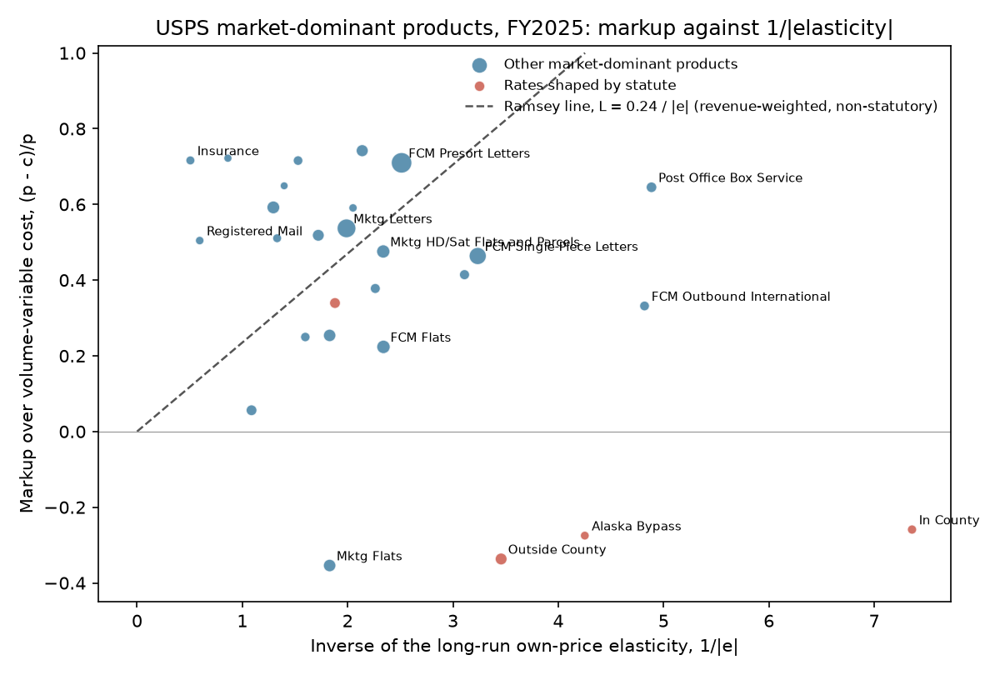
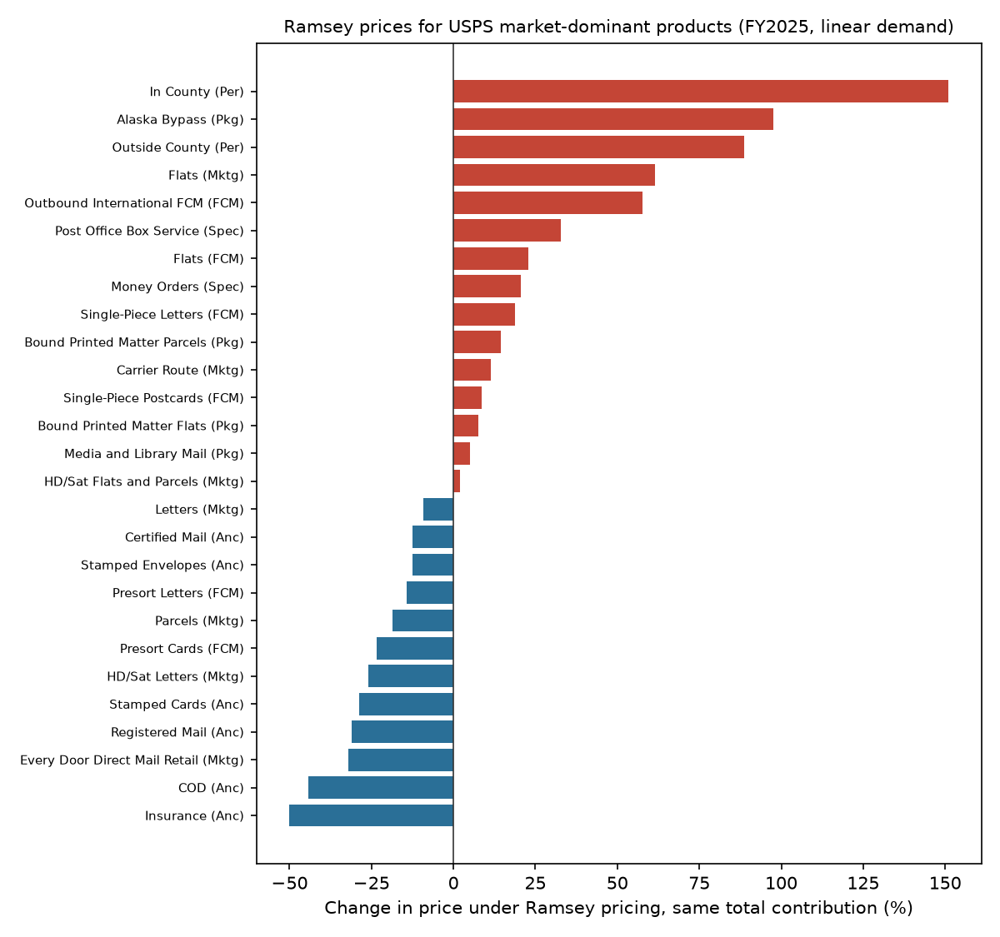

# Ramsey (1927) at the Postal Service: findings

## In plain English

Frank Ramsey showed in 1927 that a seller who must raise a fixed sum with the least harm should mark prices up most
where buyers are least able to walk away, so that markup times price elasticity is the same for every product.
Marcel Boiteux showed in 1956 that the same rule applies to a public monopoly that must break even. This study
checks the rule against the US Postal Service's fiscal 2025 prices and costs and its own demand elasticities.

- **The rule does not describe postal prices.** Across 27 market-dominant products, markups are unrelated or
  slightly negatively related to the inverse of the elasticity. Postal insurance and Registered Mail, whose buyers
  are the most price-sensitive, carry markups above 0.5; Periodicals and Marketing Mail flats are sold below cost.
- **The big products come close.** First-Class presort letters and Marketing Mail letters, the two largest
  products, have nearly the same Ramsey number (0.283 and 0.270).
- **Stamps are marked up less than bulk mail.** Single-piece First-Class letters are less elastic than presorted
  letters but carry a markup of 0.464 against 0.710, because worksharing discounts are tied to costs avoided.
- **Ramsey prices would save money.** Raising the same contribution with Ramsey prices would cut the deadweight loss
  by about $704 million a year (straight-line demand); closing the FY2025 deficit with Ramsey prices instead of a
  31.5% across-the-board increase would cost mailers about $1.19 billion a year less.

A friendlier tour is in the [README](../README.md). Method and reproduction are in [TECHNICAL.md](../TECHNICAL.md).

**Key to the labels below.** *Markup L* = (revenue − volume-variable cost) / revenue. *Cost coverage* = revenue /
attributable cost. *Elasticity* = the Postal Service's long-run own-price elasticity, volume-weighted across demand
categories. *Ramsey number* = L × |elasticity|, equal across products under Ramsey's rule. *Statutory* products are
in-county and outside-county Periodicals, Media and Library Mail, and Alaska Bypass. *Scenario A* = Ramsey prices
raising the FY2025 contribution of the 27 products; *Scenario B* = the same plus the FY2025 shortfall of all revenue
below total costs. *Price index* = counterfactual price divided by FY2025 price. *ΔCS* = change in consumer surplus
relative to FY2025 prices. *DWL* = deadweight loss relative to marginal-cost pricing (linear demand only). *k* =
common proportional cut in quantity from the marginal-cost level (Ramsey's Part II rule). All money is in millions of
FY2025 dollars a year.

## Figures

## Tables

### products.csv

| Class | Product | Revenue ($M) | Attributable cost ($M) | Volume-variable cost ($M) | Cost coverage (%) | Markup L | Elasticity | SE | Ramsey number |
|---|---|---|---|---|---|---|---|---|---|
| First-Class Mail | Single-Piece Letters | 6,775.4 | 3,754.4 | 3,633.7 | 180.5 | 0.464 | -0.309 | 0.098 | 0.143 |
| First-Class Mail | Single-Piece Postcards | 191.0 | 119.8 | 118.8 | 159.4 | 0.378 | -0.442 | 0.106 | 0.167 |
| First-Class Mail | Presort Letters | 16,095.5 | 4,753.4 | 4,670.6 | 338.6 | 0.710 | -0.398 | 0.055 | 0.283 |
| First-Class Mail | Presort Cards | 900.6 | 232.8 | 232.4 | 386.8 | 0.742 | -0.468 | 0.128 | 0.347 |
| First-Class Mail | Flats | 1,788.2 | 1,391.5 | 1,388.4 | 128.5 | 0.224 | -0.427 | 0.051 | 0.096 |
| First-Class Mail | Outbound Single-Piece First-Class Mail International | 152.5 | 101.9 | 101.9 | 149.6 | 0.332 | -0.208 | 0.192 | 0.069 |
| USPS Marketing Mail | High Density and Saturation Letters | 1,322.4 | 543.9 | 539.4 | 243.1 | 0.592 | -0.773 | 0.202 | 0.457 |
| USPS Marketing Mail | High Density and Saturation Flats and Parcels | 1,680.2 | 915.8 | 881.0 | 183.5 | 0.476 | -0.428 | 0.189 | 0.203 |
| USPS Marketing Mail | Carrier Route | 1,108.2 | 832.0 | 826.8 | 133.2 | 0.254 | -0.547 | 0.181 | 0.139 |
| USPS Marketing Mail | Letters | 10,462.5 | 5,007.9 | 4,846.6 | 208.9 | 0.537 | -0.503 | 0.198 | 0.270 |
| USPS Marketing Mail | Flats | 1,129.6 | 1,534.2 | 1,529.4 | 73.6 | -0.354 | -0.547 | 0.181 | -0.194 |
| USPS Marketing Mail | Parcels | 46.2 | 22.6 | 22.6 | 204.3 | 0.511 | -0.752 | 0.144 | 0.384 |
| USPS Marketing Mail | Every Door Direct Mail Retail | 127.4 | 36.3 | 36.2 | 350.9 | 0.716 | -0.654 | 0.107 | 0.468 |
| Periodicals | In County | 75.6 | 95.4 | 95.2 | 79.3 | -0.259 | -0.136 | 0.089 | -0.035 |
| Periodicals | Outside County | 807.6 | 1,083.8 | 1,079.5 | 74.5 | -0.337 | -0.289 | 0.066 | -0.097 |
| Package Services | Alaska Bypass | 37.1 | 47.3 | 47.3 | 78.4 | -0.275 | -0.235 | 0.152 | -0.065 |
| Package Services | Bound Printed Matter Flats | 104.6 | 78.5 | 78.5 | 133.2 | 0.250 | -0.626 | 0.277 | 0.156 |
| Package Services | Bound Printed Matter Parcels | 383.9 | 362.9 | 362.3 | 105.8 | 0.056 | -0.920 | 0.357 | 0.052 |
| Package Services | Media and Library Mail | 398.8 | 263.6 | 263.4 | 151.3 | 0.339 | -0.532 | 0.190 | 0.181 |
| Ancillary Services | Certified Mail | 788.1 | 385.9 | 379.6 | 204.2 | 0.518 | -0.581 | 0.229 | 0.301 |
| Ancillary Services | COD | 5.4 | 1.5 | 1.5 | 359.1 | 0.722 | -1.159 | 0.514 | 0.837 |
| Ancillary Services | Insurance | 52.0 | 14.8 | 14.8 | 352.3 | 0.716 | -1.974 | 0.155 | 1.414 |
| Ancillary Services | Registered Mail | 18.2 | 9.0 | 9.0 | 201.8 | 0.504 | -1.680 | 0.246 | 0.848 |
| Ancillary Services | Stamped Envelopes | 13.4 | 5.5 | 5.5 | 244.3 | 0.591 | -0.488 | 0.246 | 0.288 |
| Ancillary Services | Stamped Cards | 0.8 | 0.3 | 0.3 | 285.0 | 0.649 | -0.716 | 0.360 | 0.465 |
| Special Services | Money Orders | 220.8 | 133.1 | 129.3 | 165.9 | 0.414 | -0.322 | 0.039 | 0.133 |
| Special Services | Post Office Box Service | 332.3 | 118.0 | 117.9 | 281.5 | 0.645 | -0.205 | 0.037 | 0.132 |

### ramsey_tests.csv

| Sample | Markup over | Weights | N | Intercept | SE | Slope | SE  | CI low | CI high | p | R² | Spearman ρ | p  |
|---|---|---|---|---|---|---|---|---|---|---|---|---|---|
| All matched products | volume-variable cost | unweighted | 27 | 0.616 | 0.092 | -0.101 | 0.037 | -0.173 | -0.030 | 0.005 | 0.208 | -0.375 | 0.054 |
| All matched products | volume-variable cost | revenue-weighted | 27 | 0.560 | 0.169 | -0.015 | 0.068 | -0.149 | 0.119 | 0.829 | 0.001 | -0.375 | 0.054 |
| All matched products | attributable cost | unweighted | 27 | 0.613 | 0.092 | -0.102 | 0.037 | -0.173 | -0.030 | 0.005 | 0.210 | -0.372 | 0.056 |
| All matched products | attributable cost | revenue-weighted | 27 | 0.554 | 0.170 | -0.016 | 0.069 | -0.151 | 0.119 | 0.813 | 0.002 | -0.372 | 0.056 |
| Excluding statutory preferred rates | volume-variable cost | unweighted | 23 | 0.485 | 0.106 | -0.011 | 0.036 | -0.082 | 0.061 | 0.771 | 0.002 | -0.213 | 0.328 |
| Excluding statutory preferred rates | volume-variable cost | revenue-weighted | 23 | 0.403 | 0.186 | 0.059 | 0.079 | -0.096 | 0.213 | 0.457 | 0.025 | -0.213 | 0.328 |
| Excluding statutory preferred rates | attributable cost | unweighted | 23 | 0.483 | 0.107 | -0.012 | 0.037 | -0.084 | 0.060 | 0.744 | 0.003 | -0.211 | 0.334 |
| Excluding statutory preferred rates | attributable cost | revenue-weighted | 23 | 0.399 | 0.188 | 0.056 | 0.081 | -0.102 | 0.215 | 0.484 | 0.023 | -0.211 | 0.334 |
| Elasticity significant (t at least 1.96 in absolute value) | volume-variable cost | unweighted | 24 | 0.528 | 0.144 | -0.049 | 0.076 | -0.198 | 0.099 | 0.515 | 0.026 | -0.236 | 0.267 |
| Elasticity significant (t at least 1.96 in absolute value) | volume-variable cost | revenue-weighted | 24 | 0.497 | 0.199 | 0.013 | 0.085 | -0.154 | 0.179 | 0.883 | 0.001 | -0.236 | 0.267 |
| Elasticity significant (t at least 1.96 in absolute value) | attributable cost | unweighted | 24 | 0.528 | 0.146 | -0.052 | 0.077 | -0.202 | 0.098 | 0.499 | 0.028 | -0.233 | 0.273 |
| Elasticity significant (t at least 1.96 in absolute value) | attributable cost | revenue-weighted | 24 | 0.493 | 0.199 | 0.010 | 0.086 | -0.158 | 0.179 | 0.905 | 0.001 | -0.233 | 0.273 |
| Positive markups, log form | volume-variable cost | unweighted | 23 | -0.807 | 0.217 | -0.023 | 0.207 | -0.429 | 0.383 | 0.000 | 0.000 |  |  |

In the log-form row, p tests slope = 1.

### lambda_summary.csv

| Sample | N | Mean λ | Revenue-weighted λ | Min | Max | SD | Revenue share within 25% of weighted λ |
|---|---|---|---|---|---|---|---|
| All matched products | 27 | 0.276 | 0.228 | -0.194 | 1.414 | 0.333 | 0.636 |
| Excluding statutory preferred rates | 23 | 0.324 | 0.235 | -0.194 | 1.414 | 0.334 | 0.646 |

### usps_totals.csv

| Item | $ millions |
|---|---|
| Market-dominant revenue | 45,765.5 |
| Market-dominant attributable cost | 22,452.7 |
| Market-dominant volume-variable cost | 21,614.2 |
| Competitive revenue | 33,854.9 |
| Competitive attributable cost | 23,531.6 |
| All revenue including investment income | 81,352.9 |
| Institutional costs (All Other) | 44,143.2 |
| Total costs | 90,330.9 |
| Shortfall of all revenue below total costs | 8,978.0 |

### counterfactual_summary.csv

| Scenario | Demand | Policy | Contribution ($M) | ΔCS ($M) | DWL ($M) | Quantity change (%) | k | λ | Uniform rise (%) | ΔCS vs uniform ($M) |
|---|---|---|---|---|---|---|---|---|---|---|
| A_same_contribution | linear | actual FY2025 prices | 23,606 | 0 | 3,228 | 0.0 |  |  |  |  |
| A_same_contribution | linear | Ramsey | 23,606 | 704 | 2,523 | 1.2 | 0.176 |  |  |  |
| A_same_contribution | constant elasticity | Ramsey | 23,606 | 2,220 |  | 24.4 |  | 0.135 |  |  |
| A_same_contribution | linear | Ramsey, statutory rates held fixed | 23,606 | 531 | 2,697 | 0.8 | 0.183 |  |  |  |
| B_break_even | linear | Ramsey | 32,584 | -11,994 | 6,244 | -11.2 | 0.277 |  |  | 1,190 |
| B_break_even | constant elasticity | Ramsey | 32,584 | -8,165 |  | 24.4 |  | 0.136 |  | 3,834 |
| B_break_even | linear | Ramsey, statutory rates held fixed | 32,584 | -12,501 | 6,751 | -12.1 | 0.291 |  |  | 683 |
| B_break_even | linear | uniform increase | 32,584 | -13,184 | 7,434 | -13.8 |  |  | 31.5 | 0 |
| B_break_even | constant elasticity | uniform increase | 32,584 | -11,999 |  | -10.3 |  |  | 28.2 | 0 |

### counterfactual_products.csv (price index, FY2025 = 1.000)

| Product | Class | Revenue per piece ($) | A Ramsey | A Ramsey, statutory fixed | A Ramsey, const. elast. | B Ramsey | B Ramsey, statutory fixed | B Ramsey, const. elast. |
|---|---|---|---|---|---|---|---|---|
| Single-Piece Letters | First-Class Mail | 0.723 | 1.188 | 1.215 | 0.954 | 1.561 | 1.613 | 0.956 |
| Single-Piece Postcards | First-Class Mail | 0.585 | 1.087 | 1.106 | 0.897 | 1.354 | 1.391 | 0.898 |
| Presort Letters | First-Class Mail | 0.553 | 0.858 | 0.881 | 0.440 | 1.183 | 1.228 | 0.440 |
| Presort Cards | First-Class Mail | 0.385 | 0.765 | 0.786 | 0.363 | 1.056 | 1.097 | 0.363 |
| Flats | First-Class Mail | 2.129 | 1.228 | 1.247 | 1.136 | 1.487 | 1.523 | 1.137 |
| Outbound Single-Piece First-Class Mail International | First-Class Mail | 2.025 | 1.576 | 1.613 | 1.922 | 2.095 | 2.168 | 1.929 |
| High Density and Saturation Letters | USPS Marketing Mail | 0.220 | 0.740 | 0.754 | 0.495 | 0.931 | 0.957 | 0.495 |
| High Density and Saturation Flats and Parcels | USPS Marketing Mail | 0.214 | 1.020 | 1.041 | 0.767 | 1.304 | 1.343 | 0.768 |
| Carrier Route | USPS Marketing Mail | 0.404 | 1.113 | 1.128 | 0.992 | 1.323 | 1.352 | 0.992 |
| Letters | USPS Marketing Mail | 0.276 | 0.908 | 0.927 | 0.634 | 1.163 | 1.199 | 0.634 |
| Flats | USPS Marketing Mail | 0.677 | 1.614 | 1.625 | 1.800 | 1.763 | 1.783 | 1.801 |
| Parcels | USPS Marketing Mail | 3.951 | 0.814 | 0.827 | 0.597 | 0.999 | 1.025 | 0.597 |
| Every Door Direct Mail Retail | USPS Marketing Mail | 0.228 | 0.680 | 0.696 | 0.358 | 0.906 | 0.938 | 0.359 |
| In County | Periodicals | 0.167 | 2.510 | 1.000 | 333.294 | 3.226 | 1.000 | 650.060 |
| Outside County | Periodicals | 0.406 | 1.886 | 1.000 | 2.513 | 2.201 | 1.000 | 2.517 |
| Alaska Bypass | Package Services | 34.974 | 1.975 | 1.000 | 3.004 | 2.377 | 1.000 | 3.012 |
| Bound Printed Matter Flats | Package Services | 1.003 | 1.076 | 1.089 | 0.957 | 1.262 | 1.288 | 0.958 |
| Bound Printed Matter Parcels | Package Services | 1.699 | 1.145 | 1.154 | 1.107 | 1.261 | 1.277 | 1.107 |
| Media and Library Mail | Package Services | 5.772 | 1.051 | 1.000 | 0.886 | 1.275 | 1.000 | 0.887 |
| Certified Mail | Ancillary Services |  | 0.876 | 0.892 | 0.628 | 1.102 | 1.134 | 0.628 |
| COD | Ancillary Services |  | 0.557 | 0.569 | 0.315 | 0.717 | 0.739 | 0.315 |
| Insurance | Ancillary Services |  | 0.499 | 0.508 | 0.305 | 0.623 | 0.640 | 0.305 |
| Registered Mail | Ancillary Services |  | 0.689 | 0.697 | 0.539 | 0.800 | 0.816 | 0.539 |
| Stamped Envelopes | Ancillary Services |  | 0.875 | 0.894 | 0.567 | 1.141 | 1.178 | 0.567 |
| Stamped Cards | Ancillary Services |  | 0.711 | 0.726 | 0.433 | 0.918 | 0.947 | 0.433 |
| Money Orders | Special Services |  | 1.206 | 1.232 | 1.011 | 1.562 | 1.612 | 1.013 |
| Post Office Box Service | Special Services |  | 1.329 | 1.369 | 1.047 | 1.887 | 1.965 | 1.051 |

### demand_categories.csv

| Demand category | Equation | FY2025 volume (M pieces) | Long-run elasticity | t |
|---|---|---|---|---|
| First-Class SP / Stamped Letters | FIRST-CLASS SINGLE-PIECE STAMPED LETTERS | 6,064.3 | -0.357 | -3.06 |
| First-Class SP / Metered Letters | FIRST-CLASS SINGLE-PIECE METERED LETTERS | 3,308.2 | -0.222 | -1.25 |
| First-Class / SP Cards | FIRST-CLASS SINGLE-PIECE CARDS | 326.6 | -0.442 | -4.19 |
| First-Class / SP Flats | FIRST-CLASS SINGLE-PIECE FLATS | 407.2 | -0.696 | -7.91 |
| First-Class / WS Letters | FIRST-CLASS WORKSHARED LETTERS | 29,129.5 | -0.398 | -7.29 |
| First-Class / WS Cards | FIRST-CLASS WORKSHARED CARDS | 2,340.3 | -0.468 | -3.65 |
| First-Class / WS Flats | FIRST-CLASS WORKSHARED FLATS | 432.8 | -0.174 | -3.15 |
| Comm Mktg / Letters | COMMERCIAL MARKETING LETTERS | 29,436.7 | -0.560 | -2.27 |
| Comm Mktg / HD/Sat Letters | COMMERCIAL MARKETING HIGH-DENSITY AND SATURATION LETTERS | 5,233.9 | -0.792 | -3.71 |
| Comm Mktg / Flats & Basic CR | COMMERCIAL MARKETING LOW-DENSITY FLATS | 3,240.2 | -0.588 | -2.64 |
| Comm Mktg / HD/Sat Flats | COMMERCIAL MARKETING HIGH-DENSITY AND SATURATION FLATS | 6,965.8 | -0.407 | -2.03 |
| Comm Mktg / EDDM | COMMERCIAL MARKETING EVERY DOOR DIRECT MAIL | 559.2 | -0.654 | -6.10 |
| NP Mktg / Letters | NONPROFIT MARKETING LETTERS | 7,638.0 | -0.282 | -1.98 |
| NP Mktg / HD/Sat Letters | NONPROFIT MARKETING HIGH-DENSITY AND SATURATION LETTERS | 304.7 | -0.447 | -1.55 |
| NP Mktg / Flats & Basic CR | NONPROFIT MARKETING LOW-DENSITY FLATS | 788.9 | -0.378 | -2.91 |
| NP Mktg / HD/Sat Flats | NONPROFIT MARKETING HIGH-DENSITY AND SATURATION FLATS | 444.7 | -0.759 | -2.88 |
| Comm Mktg / Political Mail | COMMERCIAL MARKETING POLITICAL AND ELECTION MAIL | 1,115.0 | -0.815 | -3.23 |
| NP Mktg / Political Mail | NONPROFIT MARKETING POLITICAL AND ELECTION MAIL | 1,044.0 | -0.458 | -2.27 |
| Marketing / Parcels | MARKETING PARCELS | 11.7 | -0.752 | -5.22 |
| Periodical / Regular | PERIODICALS REGULAR MAIL | 1,091.2 | -0.331 | -4.51 |
| Periodical / NP & Classroom | PERIODICALS NONPROFIT AND CLASSROOM MAIL | 897.5 | -0.238 | -2.04 |
| Periodical / In-County | PERIODICALS WITHIN-COUNTY MAIL | 454.0 | -0.136 | -1.52 |
| Alaska / Bypass | ALASKA BYPASS | 1.1 | -0.235 | -1.55 |
| BPM / Flats | BOUND PRINTED MATTER FLATS | 104.3 | -0.626 | -2.26 |
| BPM / Parcels | BOUND PRINTED MATTER PARCELS | 225.9 | -0.920 | -2.58 |
| Media & Library / Rate Mail | MEDIA AND LIBRARY RATE MAIL | 69.1 | -0.532 | -2.81 |
| Postal / Penalty |  | 355.5 | 0.000 |  |
| Free-for-the / Blind |  | 20.9 | 0.000 |  |
| Outbound / International | FIRST-CLASS INTERNATIONAL LETTERS, CARDS, AND FLATS | 75.3 | -0.208 | -1.08 |
| Inbound / International | INBOUND INTERNATIONAL FIRST-CLASS NON-E-PACKETS | 58.0 | -0.406 | -1.94 |
| Registered / Mail | REGISTERED MAIL | 0.5 | -1.680 | -6.82 |
| Insured / Mail | INSURED MAIL | 5.2 | -1.974 | -12.76 |
| Certified / Mail | CERTIFIED MAIL | 157.4 | -0.581 | -2.53 |
| COD / Mail | COD MAIL | 0.3 | -1.159 | -2.25 |
| Return / Receipts | RETURN RECEIPTS | 80.4 | -0.223 | -3.90 |
| Stamped / Envelopes | STAMPED ENVELOPES | 101.5 | -0.488 | -1.99 |
| Stamped / Cards | STAMPED CARDS | 12.9 | -0.716 | -1.99 |
| Money / Orders | MONEY ORDERS | 54.3 | -0.322 | -8.30 |
| Post Office / Boxes | POST OFFICE BOXES | 38.8 | -0.205 | -5.50 |
